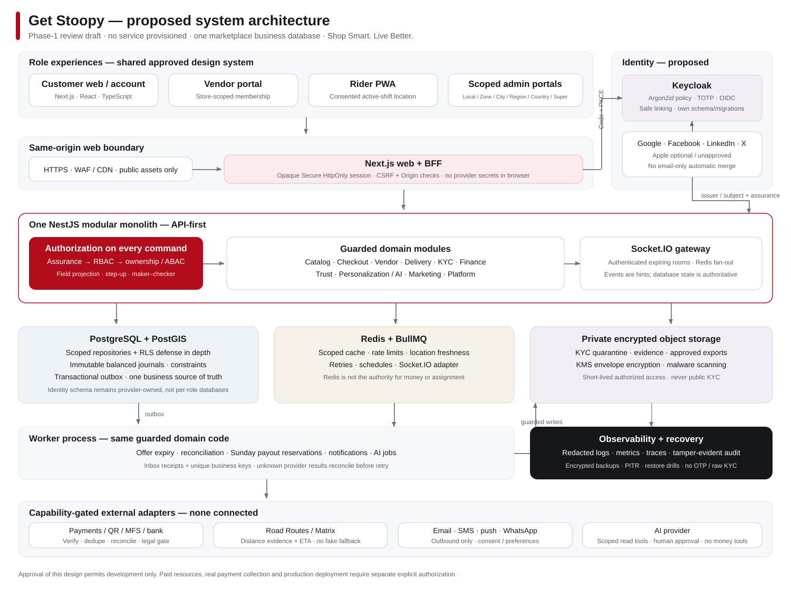

# Get Stoopy — system architecture

**Version:** 0.1 • **Date:** 2026-11-01 • **Status:** Phase-1 review draft; not implemented or production-approved.

## 1. Inspection and scope

The workspace contained five uploaded reference images and no Git repository, source code, database, environment file, deployment or lockfile. No existing user data or working application was overwritten. The public conversation was recovered from its public share page, including user audio transcriptions. Source coverage and unavailable historical artifacts are recorded in `09-source-review.md`.

This document proposes a production-oriented system; it does not claim that a marketplace, payment connection or security control already works. Implementation begins only after architecture review. No cloud resource, paid subscription or live payment collection has been created.

## 2. Architecture decisions

| Area | Proposed decision | Reason / boundary |
|---|---|---|
| Application | One TypeScript monorepo; Next.js web/BFF + one NestJS modular monolith | API-first, explicit domain services and guards; no per-role backend |
| Data | One PostgreSQL marketplace database, Prisma migrations; PostGIS | Shared consistent orders and financial records, not four role databases |
| Identity | Keycloak as the established identity provider; server-side BFF sessions | Permitted alternative to Auth.js; central password/OIDC/TOTP lifecycle instead of custom security code |
| Web | Next.js App Router, React, TypeScript, Tailwind, shadcn/ui, Zod, React Hook Form | Shared design system, SSR catalog, accessible role portals |
| Async | Separate worker process running the same domain code; BullMQ + Redis | Retries, timeout jobs, payout scheduling, notifications; not a new business microservice |
| Realtime | Socket.IO gateway inside API deployment; Redis adapter and authenticated rooms | Horizontal event fan-out; database remains authoritative |
| Files | Private S3-compatible object storage, quarantine bucket, KMS envelope encryption | KYC never uses public product CDN |
| Maps | Provider adapter; Google Maps Routes/Matrix candidate | Road distance, not a straight-line substitute; credentials and budget required |
| Payments | Provider adapters, capability registry, verified callbacks and reconciliation | No universal split-settlement, payout or Bangla QR assumption |
| AI | Permission-scoped module inside monolith; async jobs | Earlier microservice suggestion superseded by master §3/§30; extraction only after measured need |
| Delivery network | Owned rider network first; manual dispatch fallback; future courier adapter | Hybrid/third-party option retained, not falsely integrated |
| Rider client | Mobile-first PWA; optional native wrapper later | No claim of reliable background GPS or browser screenshot blocking |
| Deployment | Containers; web, API, workers and identity independently scalable | Environments isolated; production requires separate explicit approval |

### Identity alternative: why not default to Auth.js credentials?

The master allows an established identity provider. Auth.js documents that its Credentials provider does not persist data by default and leaves password, rate limiting and recovery logic to the application; its project also announces that it has become part of Better Auth. We therefore propose Keycloak rather than combining a credentials-only JWT with separately implemented revocation and TOTP. Keycloak supports Argon2-family password hashing and TOTP policies; the implementation must explicitly select/test Argon2id parameters and Google Authenticator interoperability rather than assume a default meets the requirement. [1](https://authjs.dev/getting-started/authentication/credentials) [1](https://www.keycloak.org/docs/latest/server_admin/index.html)

This adds an identity service to operate. It is a documented trade-off, not a claim of lower complexity. If the owner rejects it, the fallback is a maintained session-based auth framework with a tested credentials/database-session adapter; do not silently substitute JWT-only auth.

## 3. System context



```text
Browser / PWA
  → HTTPS + WAF/CDN
  → Next.js web + same-origin BFF (opaque HttpOnly cookie)
  → NestJS API: authentication context → RBAC → ownership / geographic ABAC
  → domain application service → scoped repository → PostgreSQL + PostGIS

Identity browser redirects ↔ Keycloak OIDC (Authorization Code + PKCE)
API ↔ Redis (cache, rate limits, location freshness, Socket.IO adapter)
API → transactional outbox → BullMQ worker → domain services / provider adapters
API ↔ private object storage (short-lived authorized access)
API ↔ maps, payment, notification and authorized KYC providers
Worker → immutable ledger, reconciliation, payout and notification jobs
All layers → redacted structured logs / metrics / traces / audit sink
```

The BFF forwards the cookie to the API over the same site. The API resolves the opaque session, current user status, roles, scope version and assurance. Provider access/refresh tokens stay server-side, encrypted; the browser does not receive database credentials, provider secrets or privileged bearer tokens. A future mobile client uses Authorization Code + PKCE and an explicitly reviewed token policy.

### Proposed repository layout (not created as application code yet)

```text
apps/web/                 Next.js pages, BFF, role portal layouts
apps/api/                 NestJS HTTP API and Socket.IO gateway
apps/worker/              BullMQ processors, schedulers, reconciliation
packages/ui/              shadcn-based accessible brand components
packages/contracts/       Zod schemas, generated OpenAPI types, event schemas
packages/config/          Validated server-only configuration and country flags
packages/testing/         Fixtures explicitly marked TEST_ONLY, contract helpers
prisma/schema.prisma      Application models; relation names follow data dictionary
prisma/migrations/        Reviewed forward migrations + PostGIS/constraint SQL
docs/                     Architecture, ADRs, runbooks, acceptance evidence
infra/                    Docker, CI, deployment templates; no secrets
 tests/unit|integration|e2e|security|performance/
```

Identity provider schema is owned and migrated by Keycloak, not Prisma. Use a separate schema and DB principals in the same approved PostgreSQL environment, or an isolated identity database if required by the provider's supported deployment. Neither option creates separate Customer/Vendor/Rider/Admin databases. Application `User` links to issuer+subject; it never treats Keycloak's console roles as marketplace authorization.

## 4. Module boundaries

| Module | Owns | Does not own |
|---|---|---|
| Identity & access | Canonical user link, sessions, roles, scopes, invitations, step-up | Vendor eligibility or financial truth |
| Geography & country | Administrative hierarchy, polygon versions, serviceability, country policy | Buyer physical-location requirement |
| Catalog & inventory | Vendor products, variants, moderation, availability/reservations | Client-provided prices or stock totals |
| Checkout & orders | Quote, buyer/recipient, parent/suborders, state transitions | Provider settlement or rider assignment races |
| Delivery | Shifts, consented locations, offers, assignments, route/rate snapshots, OTP | Cash liability as earnings |
| KYC | Cases, documents, individual decisions, expiry, authorized verification | Government database scraping |
| Finance | Payments, refunds, commission, balanced journals, COD, payouts/settlements | Frontend confirmation or mutable balances |
| Trust & support | Fraud evidence, review decisions, returns, tickets, SOS | Automatic rejection solely for VPN use |
| Personalization & AI | Consented interests, recommendations, scoped assistants | Other apps' audio or autonomous sensitive operations |
| Marketing & loyalty | Campaigns, coupons, subscriptions, rewards/referrals | Unverified advertising claims or hidden fees |
| Platform | Outbox/inbox, idempotency, notifications, audit, flags, health | Business permission bypass |

Each write goes through one application command. Workers and AI tools call the same guarded service, never raw SQL shortcuts. Cross-module synchronous calls have explicit interfaces; eventual projections use versioned events. Extract a service only for measured scaling, isolation or organizational need.

## 5. Order and delivery design

1. Authenticate buyer; select **Deliver to Myself** or **Deliver to Someone Else**.
2. Snapshot recipient name/phone/address separately. Resolve the **destination** polygon on the server. Buyer GPS is optional risk evidence, not an availability filter.
3. Group eligible items by vendor and pickup store. Reserve inventory with an expiry; compute price, promotion, tax, per-group delivery fee and ETA from authoritative data. A quote has a version, hash and expiry.
4. Create payment/COD intent, fraud decision and idempotency record. For prepaid orders, vendor fulfillment starts after verified payment unless an explicitly approved alternate policy exists.
5. In one transaction create one parent, vendor/store suborders, item snapshots, recipient snapshot, initial status events and outbox events. A vendor sees only its suborder and minimum recipient fulfillment data, never other vendors' items or margins.
6. Vendor accepts/rejects, sets preparation estimate, then **manually** confirms ready. Timer expiry never confirms readiness. Delay updates are audited and do not add waiting-time earnings.
7. Ready event starts dispatch. PostGIS shortlists eligible riders; road-route matrix orders candidates. Offer to exactly one rider for 30 seconds using server time. Timeout/reject advances the sequence; exhaustion escalates to authorized local dispatch staff.
8. Acceptance locks delivery and rider rows, rechecks offer expiry, KYC, shift, zone, capacity and stale location; creates one active assignment and rate snapshot. Socket messages are hints, not assignment authority.
9. Pickup confirmation → in transit → recipient OTP verification → delivered. COD collection must be accounted before delivery completion. A failed delivery has an explicit exception/return workflow, not normal earnings.
10. Completion emits immutable earning and commission events subject to the successful-order policy. Refunds/returns use reversing entries. Parent status is derived from suborders; partial fulfillment/cancellation remains visible.

Initial release: one suborder has one active rider; rider capacity defaults to one. Batching/multi-pickup optimization is a later flag, not an excuse for double assignment. Manual assignment uses the same eligibility and rate policies, with reason and audit trail. Courier integration remains disabled until a real contract/API exists.

### Important state distinctions

- Payment: `INITIATED → PENDING_VERIFICATION → PAID / FAILED / CANCELLED`; later `PARTIALLY_REFUNDED / REFUNDED / DISPUTED`.
- Suborder: `PENDING_VENDOR → ACCEPTED → PREPARING → READY_FOR_PICKUP → FULFILLING → DELIVERED → COMPLETED`; rejection/cancellation are explicit branches.
- Delivery: `QUEUED → OFFERED → ASSIGNED → PICKED_UP → IN_TRANSIT → DELIVERED → COMPLETED`; failed/return exceptions retain history.
- KYC, fraud, payout and refund statuses are separate. The screenshot labels “Delivered” and “Completed” are not interchangeable financial events.

## 6. Authorization and data isolation

Every request builds an immutable `AccessContext`: user, session assurance, active roles, permissions, vendor memberships, rider identity, scope assignments and authorization version. Require permission **and** resource ownership/scope. A URL role prefix, hidden menu or client filter grants nothing.

The repository requires a typed scope predicate. Core tenant/geographic tables receive PostgreSQL row-level security as defense in depth. Within a transaction use `SET LOCAL` for verified actor/scope context; never interpolate client headers into SQL. Pooling must not leak session context. Migrations use a separate owner; runtime has no superuser or BYPASSRLS privilege. Super Admin global access is an explicit audited policy, not a shared database login.

RLS alone cannot express every business join. Service guards, scoped queries, RLS, field projection and negative API tests all remain required. See `03-role-permission-matrix.md` and `04-geographic-model.md`.

## 7. Financial integrity

Use balanced double-entry journals in integer minor units. `VendorLedger`, `RiderLedger`, `CODLedger` are purpose-specific views, not separate mutable wallets. A journal's debit total equals its credit total per currency; append-only constraints prevent update/delete. A business-event unique key prevents duplicate earning, deposit verification, refund or payout posting. Corrections are linked reversals.

Rider pay uses a versioned **store-to-recipient road-distance** slab captured on final acceptance (proposed policy). Rider-to-store road distance controls dispatch ordering, not extra earnings. Rate edits create future versions. Traffic may improve ETA but does not alter fixed slab pay. COD collected is a liability; only verified deposits reduce it. Payout reserves funds before sending; unknown provider outcomes reconcile the original attempt rather than blindly retrying a new transfer. See `06-finance-and-delivery-policy.md`.

## 8. Failure behavior and reliability

| Failure | Required behavior |
|---|---|
| Payment callback delayed/duplicated | Order remains pending; verify provider transaction; deduplicate event; reconcile |
| Maps unavailable | No fake road distance or silent slab estimate; retry/queue or authorized manual exception |
| Redis unavailable | Reject/rate-limit sensitive operations as configured; no unpaid privilege escalation; DB idempotency remains |
| Worker crash/retry | Outbox/inbox + unique domain keys; safe replay; no duplicate financial effects |
| Socket disconnect | Reconnect and fetch authoritative state; offer expiry still enforced in DB |
| Rider GPS stale/out of zone | Stop new offers, warn/escalate; do not auto-cancel an active delivery or suspend solely for GPS noise |
| Provider payout result unknown | Mark `PROCESSING_UNKNOWN`, reserve remains, reconcile before any retry |
| AI unavailable | Ordinary search/catalog/checkout continue; assistant shows unavailable state |
| Primary DB failure | Controlled write unavailability; tested restore/failover runbook; never invent successful writes |

Initial proposed service objectives (to approve and test, not achieved results): monthly availability 99.9%; marketplace RPO ≤15 minutes and RTO ≤4 hours; identity recovery included in drills. Financial journal restore requires reconciliation before reopening payouts. No zero-downtime, zero-latency or zero-bug promise.

## 9. Performance budgets

- Public landing/product pages: SSR/streaming, responsive AVIF/WebP, explicit dimensions, priority only for hero; lazy-load below fold.
- Mobile reference conditions: 4G, mid-tier Android; p75 LCP ≤2.5s, INP ≤200ms, CLS ≤0.1. Initial route JS ≤200KB compressed excluding images; record exceptions.
- API p95 ≤300ms for cached catalog reads and ≤700ms for non-provider order commands at the agreed pilot load; external provider latency reported separately.
- Cursor pagination default 20, max 100; no unbounded orders/products; maximum search/filter complexity; no N+1 queries.
- Explain plans for top queries; indexes for tenant/status/time, order references, variant/store stock and geography. Load-test realistic pilot concurrency before choosing capacity.
- Cache public catalog by country/zone/currency/locale; never shared-cache authenticated pages, KYC, recipient data or financial responses. Invalidate by versioned events.
- Dashboard charts aggregate server-side with scope and time range. Reference-image numbers are not benchmark results.

## 10. Deployment and operations

Local Docker Compose will provide PostgreSQL/PostGIS, Redis, identity, object-storage emulator and mail capture, all test-only. CI pins actions/dependencies, typechecks, lint/tests, migration checks, API contract checks, accessibility and security scans. Staging uses separate credentials/buckets/databases and provider sandboxes; production deployment is a separate authorized gate.

Managed PostgreSQL with PITR/encrypted backups, private networking, KMS, WAF, CDN, object scanning, secret manager, OpenTelemetry-compatible traces and an error tracker are proposed resources. **None has been provisioned.** Cloud choice, residency, budget, domain, merchant entity and on-call ownership remain decisions. Structured logs exclude passwords, session tokens, TOTP, full NID/bank data, recipient OTP and raw location streams. Audit storage is restricted and tamper-evident.

## 11. Critical risks and review gates

1. **Money movement authority:** ordinary merchant APIs do not establish legal marketplace collection/split settlement. Central Bangla QR remains disabled until acquirer contract and flow are confirmed.
2. **Cross-scope leakage:** destination-based order visibility, buyer residence and vendor location differ; test remote orders, reports, exports, sockets and AI against the same scope policy.
3. **Double spending/assignment:** ledger, payout, inventory and rider races require database constraints and concurrency tests, not Redis locks alone.
4. **Identity and KYC exposure:** mandatory admin TOTP, protected linking, encrypted documents, strict reviewer access and a tested emergency lock.
5. **Provider and mobile limits:** OAuth apps, MFS payouts, routing, QR, background GPS and screenshot controls need real capability verification.
6. **Scope inflation:** historical feature requests are retained but feature-flagged; secure core order/finance paths precede optional AI/loyalty/native features.
7. **Unverified reference claims:** “worldwide shipping”, “free shipping on all orders”, payment logos and sample US contact details are not launch configuration.

Approval of this architecture authorizes Phase 2 implementation in a development environment only. It does not authorize paid services, real identity-document collection or production deployment.
